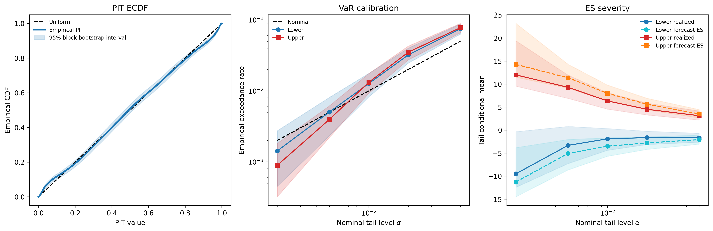
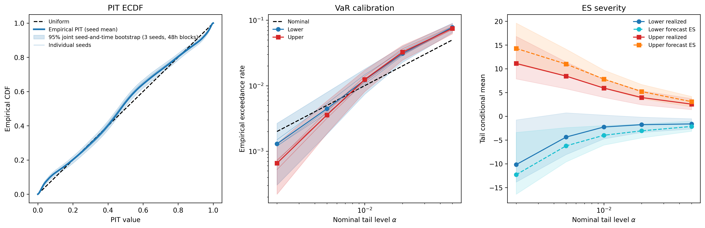
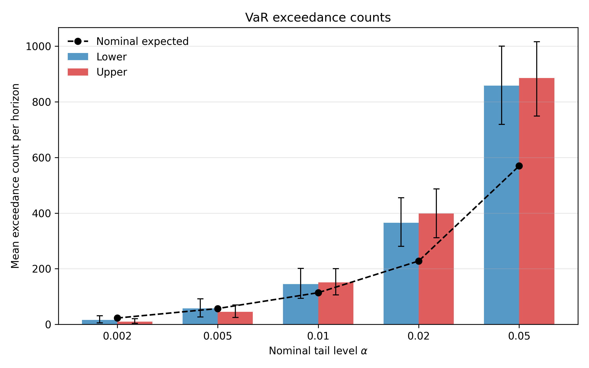

<div style="margin: 0; padding: 0; text-align: center; border: none;">
<a href="https://quantlet.com" target="_blank" style="text-decoration: none; border: none;">

</a>
</div>

```
Name of Quantlet: Onchain Insights - Evaluation of Probabilistic Forecasts

Published in: Onchain Insights - Evaluation of Probabilistic Forecasts

Description: This Quantlet computes a suite of probabilistic diagnostics in order to evaluate the probabilistic forecasting abilities of our model for depeg in the Uniswap pool.

Keywords: Cryptocurrency, Blockchain, Stablecoins, Decentralized Finance, Liquidity, Depeg risk

Author: Owen Chaffard

Submitted: 06.10.2026

Datafile: curve_3pool_hourly.parquet, hourly_pool_state_full.parquet

```
<div align="center">

</div>

<div align="center">

</div>

<div align="center">

</div>

